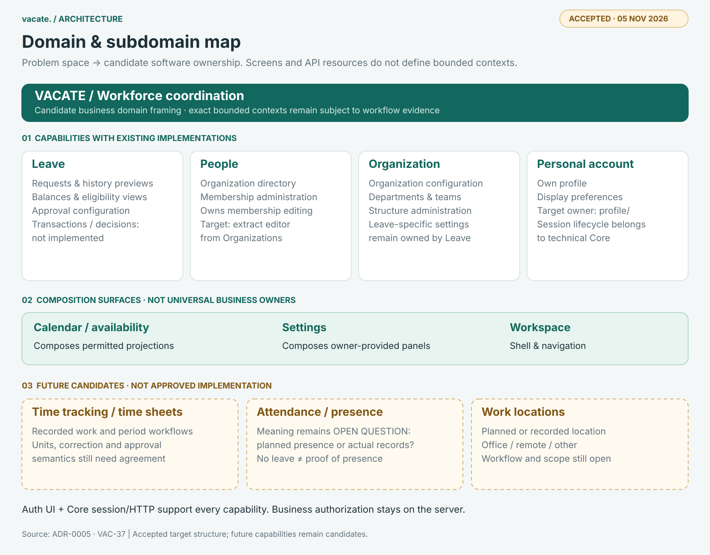
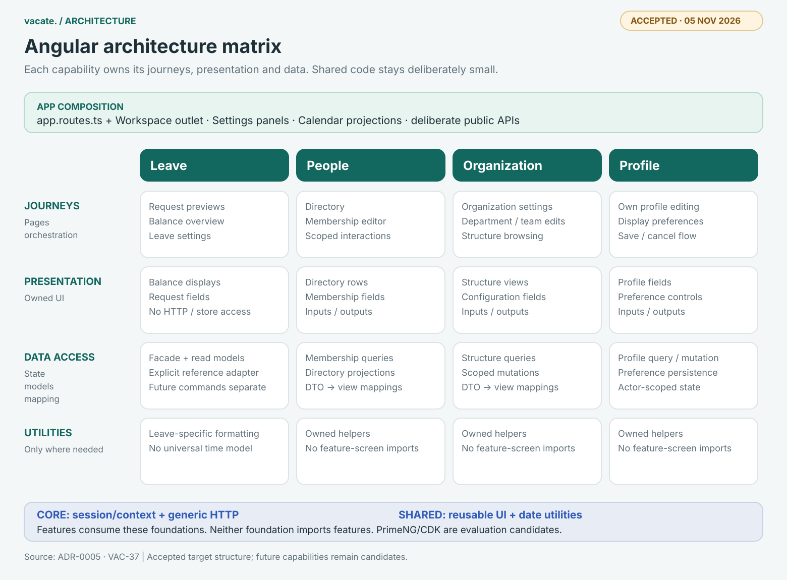
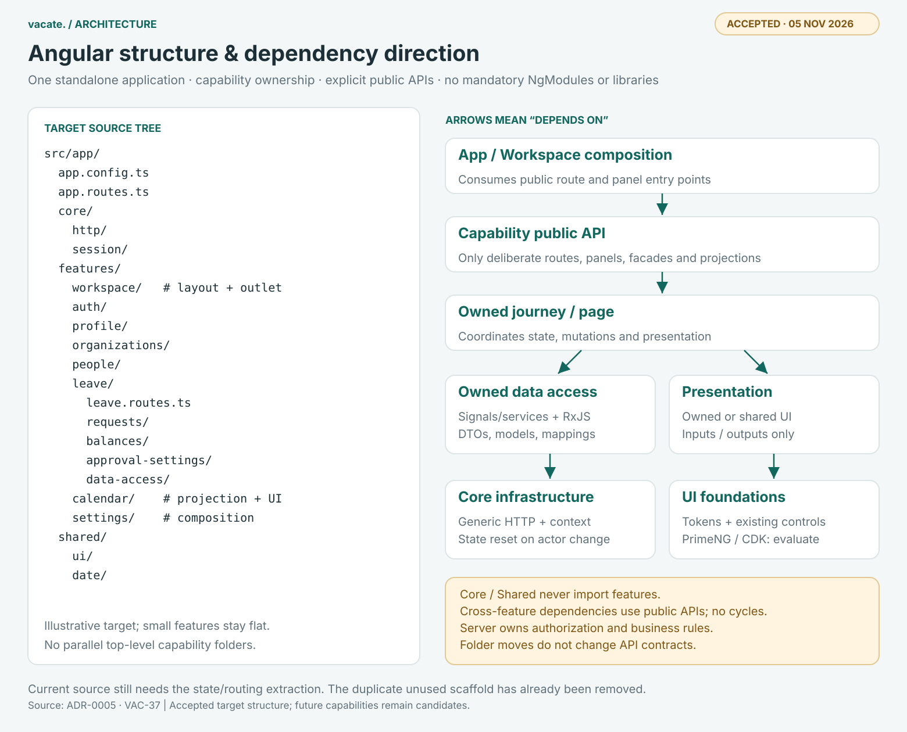

# ADR-0005: Frontend capability architecture

Status: ACCEPTED  
Date: 2026-11-05  
Owner: Product lead / founder

## Context and scope

Vacate needs clearer ownership as leave evolves and future time sheets, attendance/presence and work locations are considered. The product lead requested a dedicated frontend ADR: ADR-0003 remains backend/integration authority, not a frontend folder-layout constraint. Accepted by the product lead on 2026-11-05; this supersedes ADR-0003’s Angular layout paragraph only.

This decision defines the target architecture, not completed migration or a verified deployment. [VAC-37](../jira/VAC-37-frontend-architecture-review.md) records acceptance, review evidence and the separately authorized scaffold cleanup. [VAC-21](../jira/VAC-21-codex-agent-context.md) records the related role-guidance correction.

## Current gaps

- [Workspace data](../../frontend/src/app/core/state/workspace-data.service.ts) and [workspace API](../../frontend/src/app/core/state/workspace-api.service.ts) combine session, profile, organization, leave references and refresh lifecycles.
- [Routes](../../frontend/src/app/app.routes.ts) load one [workspace](../../frontend/src/app/features/workspace/workspace.ts) that statically imports the major screens; capabilities are not independently lazy-loaded.
- [Shared models](../../frontend/src/app/core/models/workspace.models.ts) mix business, fixture and view state; [transport contracts](../../frontend/src/app/core/http/contracts.ts) depend on UI types.
- [People](../../frontend/src/app/features/people/people.ts) reuses the organization editor in membership-only mode; [Settings](../../frontend/src/app/features/settings/settings.ts) mixes composition with capability configuration.
- [Calendar](../../frontend/src/app/features/calendar/calendar.ts) consumes leave fixtures through broad workspace state; root/global styles also couple feature presentation.

Cleanup completed in this change: removed unused top-level `app/leave`, `app/people`, `app/availability`, `app/approvals` route/heading placeholders and `core/layout/shell`, including their empty directory markers. Active `features/` implementations and existing URL registrations are retained.

## Decision

[Visual companion: domain map, architecture matrix and Angular dependency structure](../design/architecture/README.md).







Keep one standalone Angular application, organized by business capability. A logical module does not require an NgModule, library or separate deployable. Folder names and backend resources do not establish DDD bounded contexts.

```text
app/
  app.config.ts
  app.routes.ts                 # Composition and legacy URL mapping
  core/
    http/                       # Generic HTTP and runtime configuration
    session/                    # Session, actor/organization context and reset
  features/
    workspace/                  # Layout, navigation and composition
    auth/
    profile/                    # Own profile and account preferences
    organizations/              # Organization structure and administration
    people/                     # Directory and membership administration
    leave/
      leave.routes.ts           # Public route entry point
      requests/
      balances/
      approval-settings/
      data-access/              # Owned state, clients, DTOs and mappings
    calendar/                   # Authorized availability projections and UI
    settings/                   # Composes public settings panels
  shared/
    ui/                         # Evidenced reusable presentation
    date/                       # Explicit date-only utilities
```

The tree is illustrative; small features stay flat and no empty layers are required. Leave initially owns request composition/history, balances, eligibility and leave approvals. Settings is a composition surface; organization-scoped leave configuration still belongs to Leave. Calendar composes permitted projections rather than owning every time-related transaction. Personal leave details and colleague availability remain separate projections.

### Dependencies, state and data access

- App composition imports deliberate feature route/panel APIs. The workspace uses a router outlet instead of importing every screen. Preserve direct/query/legacy URLs, Back/Forward/reload, date/scope/view preferences and focus return.
- UI uses its owner's state/query/mutation services. Features expose only needed routes, panels, facades or projection types; cross-feature dependencies use these APIs and stay acyclic. Core/shared never import features.
- Keep generic infrastructure in Core. Move capability-specific clients, DTOs, models and mappings to their owners; allow a small shared resource API when multiple workflows justify it. Avoid universal business models and backend-layout mirroring.
- Core owns session/context. Capabilities own loading/error/empty state, caches and invalidation. Choose provider scope by required lifetime. Reset sensitive state on sign-out/account change, scope caches by actor/organization, and reject stale async results. A profile save should not reload unrelated administrator data.
- Retain signals/services and RxJS; no new global store is required. Keep fictional reference adapters explicit and write doubles testing-only. The server remains authoritative for policy, authorization, calculations and UTC lifecycle timestamps.
- Keep date-only values, instants and durations distinct; do not infer presence from absence of leave or convert a leave day into eight hours.

### UI reuse and PrimeNG evaluation

Retain Vacate's visual identity and existing tokens. Move feature styles beside their views; keep global reset/tokens and genuinely reused presentation shared. Import UI dependencies explicitly in standalone consumers rather than through a global catch-all module. Wrap vendor controls only for repeated Vacate behavior or accessibility conventions.

PROPOSED: evaluate PrimeNG separately using one existing settings form and one table. Configure providers/theme centrally and customize through tokens. Check Angular compatibility, forms, keyboard/focus, overlays, narrow screens, both existing color schemes, global CSS interactions and bundle impact before adoption. Angular CDK is an alternative for specific custom interaction needs; avoid overlapping complete UI suites.

No dependency is selected or installed by this ADR. PrimeNG 22 uses PrimeUI's Community/commercial licensing model; earlier MIT releases retain their terms. Eligibility, maintenance and cost require a separate selection decision. Sources checked 2026-11-05: [installation](https://primeng.dev/installation), [theming](https://primeng.dev/theming/styled), [licensing announcement](https://primeui.dev/nextchapter), [license options](https://primeui.dev/licenses).

## Migration and verification

Temporary migration guidance: on verified migration completion, remove this transition plan, the Current gaps section and cleanup notes from this ADR, and revise diagram annotations to describe the architecture without historical comparisons. Preserve baseline findings, migration steps and execution evidence in the issue history. Retain standing architecture and verification requirements here.

1. Extract session/context and capability state/models/clients, preserving contracts and stale-response checks.
2. Give People membership editing and Leave its settings panels through deliberate public APIs.
3. Introduce independently lazy capability routes under the workspace layout, with compatibility mappings.
4. Decouple calendar projection/rendering, move owned styles, and enforce agreed import boundaries with existing tooling. Evaluate UI dependencies separately.

Each slice needs an acceptance scenario, focused existing tests, both TypeScript projects and a production build. Routing/data changes also need paired API/browser checks: legacy/history navigation, keyboard/focus/mobile, failure and permission-revocation paths, account changes with pending responses, foreign-organization denials and server timestamps. Verify unrelated capabilities do not initialize on navigation; inspect build chunks before claiming loading/performance improvements.

For the unused-scaffold cleanup, verify no remaining imports/selectors, compile both TypeScript projects, run existing frontend tests and build. No access/data path changes, so no new tenant-isolation test is needed; this cleanup does not certify runtime isolation. Results belong in VAC-37.

## Tradeoffs and open decisions

Capability ownership reduces shared loading/state coupling but requires explicit mappings, invalidation and URL compatibility. Renaming folders alone would not solve those problems. No BFF, microfrontends, Nx, Sheriff or new state framework is justified here; API/schema/backend behavior is unaffected.

OPEN QUESTION: sequencing of the broader refactor; PrimeNG selection; presence meaning (planned versus recorded); approved time-sheet/location workflows and capability enablement/permissions. Future capabilities and a combined approval inbox remain proposals, with distinct workflow owners rather than a universal time/approval engine.

Angular guidance checked 2026-11-05: [feature organization](https://angular.dev/style-guide), [routing](https://angular.dev/guide/routing/define-routes), [provider scopes](https://angular.dev/guide/di/hierarchical-dependency-injection). These support the approach; Vacate's frontend ownership rules are accepted by this decision; future product boundaries remain proposals.
