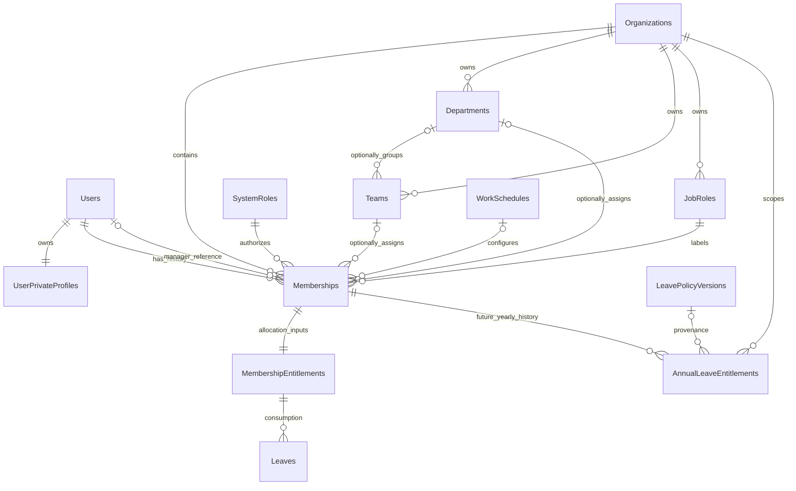

# Relational model and column catalogue

Status: Stage A implemented under accepted ADR-0004; Stage B/C remain design boundaries · updated 2026-11-02 (design 2026-11-01) · [VAC-23](../jira/VAC-23-database-erd-and-catalogue.md).

Sources, in precedence order: accepted [ADR-0001](../adr/0001-company-first-web-api.md), [ADR-0003](../adr/0003-domain-and-application-services.md), [charter](../product/product-charter.md), [user contract](../contracts/user.md), [organization contract](../contracts/organization.md), [current API](../contracts/api.md), and [VAC-22 decision register](../jira/VAC-22-relational-database-schema.md). ADR-0004 was accepted on 2026-11-02. Stage A was subsequently implemented and its baseline applied to the existing free dev database; see [implementation and evidence](implementation-stage-a.md). Stage B/C physical choices remain proposals and introduce no product decisions.

## Model boundaries

Stage A maps existing Users, Memberships, Organizations, Departments, Teams and role/schedule references. Stage A compatibility rows preserve current fictional balance/provisioning behavior without manufacturing policy history. Stage B describes accepted allowance/history direction, but needs separate runtime work (VAC-30). Stage C records future extension boundaries, not a ready migration catalogue. No policy figures, identity provider, generic organization graph or non-login employee entity is invented.

CompanyId references Organizations.Id for the company-shaped MVP only. Users and shared reference catalogues are global. A tenant-owned row always carries CompanyId, even when derivable from its parent. Global GUID lookup is followed by authorization; database relationships do not grant rights. Private family data has a separate table and explicit allowlisted projections.

A user has zero or one non-deleted membership, plus removed history; the diagram's many cardinality describes that history and preserves a future multi-company migration path. An organization may have no departments, no teams and initially no accepted administrator while its first invitation is pending. A team can stand alone. A manager is a User reference validated through active same-company membership, not an authorization role. Policy versions and yearly history are Stage B/C, not existing domain entities.

## Shared physical conventions

Unless a row is explicitly a dependent value below, every entity has these columns. All fields are NOT NULL unless marked `?`.

| Column | Proposed SQL type | Ownership / meaning |
|---|---|---|
| Id | int, positive, PK | Numeric internal identity; SQL sequence, see mapping plan |
| Guid | uniqueidentifier, unique | Immutable public identity, generated server-side; never an authorization token |
| CreatedAt, UpdatedAt | datetimeoffset(7) | Server-owned UTC offset zero; preserve imported values |
| DeleteRequestedAt?, DeletedAt? | datetimeoffset(7) | UTC lifecycle, null initially; deletion is not erasure |
| RowVersion | rowversion | Infrastructure concurrency token; not a business timestamp or API field |
| CompanyId | int FK where tenant-owned | Organizations.Id; organization root uses its own Id |

Dependent rows use their owner's identity/lifecycle rather than inventing independent domain identities: UserPrivateProfiles and MembershipEntitlements use owner PK/FK plus RowVersion. Leaves uses numeric Id plus unique immutable GUID and explicit tenant/entitlement keys. WorkScheduleDays is a value collection. Stage C entities will follow shared conventions if adopted; append-only event records must forbid mutation despite lifecycle columns.

Text lengths below match current DomainValue.Name (200), except explicitly proposed bounded provenance/code fields. Use nvarchar and an explicit binary collation on the already application-normalized Username; preserve trim + invariant lower normalization, no provider-specific email aliases. Do not duplicate Email: it is derived from Username. RowVersion is binary(8) on reads, generated by SQL on writes.

## Stage A: current resource rows

Each row below adds columns to shared conventions. References are numeric FK columns. `?` means nullable, and all other listed columns are required.

| Table / owner | Additional columns and types | Mapping / null semantics |
|---|---|---|
| Users / global | Username nvarchar(200); FirstName, LastName nvarchar(200); MiddleName? nvarchar(200); Gender nvarchar(16); Status nvarchar(16) | Normalized globally reserved username; gender woman/man/unspecified; status active/disabled. Removed usernames remain reserved to preserve current repository behavior; any reuse requires a decision. No passwords/session tokens. |
| ApiSessions / global account dependent | TokenHash char(64), binary-collated SHA-256 uppercase hex PK; UserId int FK; CreatedAt, ExpiresAt datetimeoffset(7) | Accepted 2026-11-13 ADR-0004 amendment. Minimal infrastructure ticket row, with no domain ID/GUID, tenant claims or raw bearer token. UTC instants and expiry later than creation are checked. User and expiry indexes support revocation and bounded expired-row cleanup. Runtime SELECT/INSERT/DELETE only; tickets are immutable and activity never extends expiry. |
| UserPrivateProfiles / global dependent | UserId int PK/FK; Married bit; DependentChildren int; SoleCare bit; RowVersion | Required one-to-one created atomically with User. Defaults false/0/false are applied by domain, not interpreted as legal evidence. Family exclusion retained. No CompanyId because facts belong to account; no colleague/admin family projection. |
| Organizations / tenant root | Name nvarchar(200); IsDemo bit NOT NULL DEFAULT 0; WorkWeekDays tinyint; RequireVacationApproval bit; DepartmentLeadSettingsEnabled bit; TeamLeadSettingsEnabled bit; CarryoverEnabled bit; CarryoverYears int | Five/six-day setting, not detailed working schedule. Legacy CarryoverYears 0 = unlimited when enabled. No processing inferred. |
| Departments / tenant | CompanyId int; Name nvarchar(200); RequireVacationApproval? bit | Null inherits organization; false is explicit. |
| Teams / tenant | CompanyId int; DepartmentId? int; Name nvarchar(200); RequireVacationApproval? bit | Department optional; same-company FK. Null approval inherits department then organization. |
| Memberships / tenant | CompanyId, UserId, SystemRoleId, JobRoleId int; SettingsRole nvarchar(24); DepartmentId?, TeamId?, ManagerUserId? int; HireDate?, EmploymentEndDate? date; PriorServiceYears? decimal(18,8); WorkScheduleId?, HolidayCalendarId?, LeavePolicyId? int | Null assignment/configuration stays unknown/unassigned. Domain PriorService maps to PriorServiceYears, preserving years. Schedule reference is shared in current catalogue; calendar/policy references are nullable and unresolved (see below). SettingsRole employee/teamLead/departmentLead/owner/hr remains separate from job title. |
| SystemRoles / global fixed | Name nvarchar(200) | Stable existing numeric and GUID mappings: admin=1, employee=2. Not platform privileges. |
| JobRoles / tenant | CompanyId int; Name nvarchar(200) | One title per membership; no inferred permission, no new name-uniqueness rule. |
| WorkSchedules / global current catalogue | Name nvarchar(200) | Current IRoleCatalog.WorkSchedules is shared; keep existing reference identities. Day patterns/effective dates/ownership need later review. |
| MembershipEntitlements / tenant dependent | MembershipId int PK/FK; CompanyId int; PeriodStart, PeriodEnd, AsOf date; PolicyVersion? nvarchar(200); PolicyMinimum?, CustomAllocation? decimal(12,4); RowVersion | Current period/allocation inputs only; no stored consumption or remaining totals. PolicyVersion stays opaque, not a fabricated policy-version FK. |
| Leaves / tenant dependent | Id int IDENTITY PK; Guid uniqueidentifier UNIQUE; CompanyId, MembershipId int; EntryKind nvarchar(24); Status nvarchar(16); QuantityDays decimal(12,4); StartDate?, EndDate? date; Source nvarchar(200); CreatedAt, UpdatedAt datetimeoffset(7); RowVersion | Same-company membership/entitlement FKs. Positive day quantities; Used/Pending summed on read, Cancelled excluded. ImportedOpening has null dates and unique accounting bucket; RecordedLeave requires ordered dates. Runtime SELECT only, no public leave workflow. [Detailed mapping/migration](derived-leave-balances.md). |

PriorService decimal precision is a physical proposal, not a recognition/rounding rule. Reject values not exactly representable rather than round them; audit existing decimal range/scale before migration. Same rule applies to decimal(12,4) quantities: allowed physical range is not an entitlement rule. No uniqueness on names unless already guaranteed by a contract.

Initial implementation gate (resolved for Stage A on 2026-11-02): current fixtures have only null calendar/policy references and the API rejects non-null values; the initial migration enforces both columns null. Future catalogue ownership remains an OPEN QUESTION. Calendar/policy entities do not yet exist in the runtime catalogue. Inspect all existing IDs before migrating; reject dangling references. Either introduce reviewed reference-only catalogues preserving IDs or defer non-null references until their owning feature. Do not disable FK checking or create fictional policy definitions. The initial migration cannot include FK columns pointing at nonexistent tables without resolving this gate.

Development provisioning grants/invitation markers and display-key/team-lead presentation are outside the domain persistence above. Stage A explicitly adds DevelopmentProvisioningAccess (UserId/CompanyId composite PK and restrictive FKs; Invited/CanProvision bits, unique Invited UserId filter) as opt-in fictional compatibility metadata. Display/team-lead presentation remains in the existing opt-in fixture adapter. They cannot be translated into real invitations or production platform grants.

## Stage B: accepted annual allowance direction, future runtime

| Table / owner | Additional proposed columns | Behavior / implementation gate |
|---|---|---|
| Organizations | DefaultAnnualVacationDays? decimal(12,4) | Organization suggestion for Custom mode. Null means no suggestion. No live fallback for Use policy. Cutoff configuration needs timezone/effective-date decisions before physical fields are finalized. |
| Memberships | AnnualAllowanceOverrideDays? decimal(12,4) | Absolute annual allowance before use; null stays dynamic policy inheritance. Never decrement or backfill a policy result into this column. |
| AnnualLeaveEntitlements / tenant entity | CompanyId, MembershipId int; EntitlementYear smallint; Revision int; PolicyVersionId? int; CalculatedPolicyDays?, AppliedAllowanceDays? decimal(12,4); CarryoverDeadline? datetimeoffset(7); CalculatedAt datetimeoffset(7); EvaluationState nvarchar(16); EvaluationInputs nvarchar(max); SupersedesId? int | PROPOSED append-only revisions, unique company/member/year/revision. EvaluationState known/unknown; known requires reviewed version, policy/applied quantities and deadline. Unknown results stay null with bounded missing-input provenance, never zero. Revision selection and effective dates need acceptance before runtime. No used/pending/carry addition in applied allowance. |

EvaluationInputs is proposed versioned, allowlisted JSON with input schema version, source/version identifiers, hire/service/workweek inputs and evaluator version, not a dump of private profiles or tokens. Application size bound proposed 16 KiB; SQL ISJSON check. Privacy review must approve minimal inputs/access/retention. PolicyVersionId and SupersedesId require company-consistent references; historical versions must be immutable. No year row is fabricated from the current snapshot's free text.

Accepted examples are arithmetic scenarios, not statutory rules: policy 22 / organization 25 / null → policy 22; explicit 23 is rejected on a new edit; explicit 25 passes known floors. Custom mode suggests 25 but Use policy stays null. Unknown policy keeps evaluation unresolved. A previously valid explicit 21 that becomes below policy 22 remains 21, with future admin warning/notification (VAC-33); no automatic increase or mandatory review. Current AnnualBalance constructor rejects that stale override: runtime model must change under VAC-30, not during VAC-26 compatibility persistence. History is not overwritten on 1 January.

## Stage C: extension catalogue, excluded migrations

These proposed columns identify storage boundaries only; final requiredness, lengths, state transitions and version uniqueness need the listed feature decisions. Each tenant entity adds CompanyId and shared conventions.

| Future table / ownership | Candidate columns (nullable marked ?) / relations | Gate |
|---|---|---|
| PlatformRoles / global | Code nvarchar(64), Name nvarchar(200) | Fixed backoffice role only; no permission engine |
| PlatformRoleAssignments / global | PlatformRoleId int, PrincipalReference nvarchar(200), GrantedByPrincipalReference? nvarchar(200) | Identity/provider binding and bootstrap audit; no company access inferred; VAC-27/28 |
| MembershipInvitations / tenant | RecipientNormalizedEmail nvarchar(200), SystemRoleId int, JobRoleId? int, DepartmentId?, TeamId? int, TokenHash? binary(32), ExpiresAt datetimeoffset(7), AcceptedAt?, RevokedAt? datetimeoffset(7), ReplacesId? int | Token mechanism/provider not selected. Issuance creates no User/Membership. Seven-day, single-use, email-bound acceptance; resend invalidates old link; VAC-29 |
| WorkScheduleDays / dependent shared current schedule | WorkScheduleId int, Weekday tinyint, WorkingMinutes? smallint | Composite PK schedule/day; effective dating/tenant ownership unresolved; no assumed eight-hour conversion |
| HolidayCalendars, HolidayDates / proposed tenant | Calendar: Name nvarchar(200); Date: HolidayCalendarId int, Day date, Name nvarchar(200) | Unique calendar/day; country source and ownership review |
| LeaveTypes / ownership OPEN QUESTION | Code nvarchar(64), Name nvarchar(200), AllocationKind nvarchar(16), Unit nvarchar(8) | Annual/event-based rules and catalogue ownership, not quotas |
| LeavePolicies, LeavePolicyVersions / proposed tenant | Policy: Name nvarchar(200); Version: LeavePolicyId int, Version int, EffectiveFrom date, EffectiveTo? date, SourceReference nvarchar(200), Configuration nvarchar(max) | Version immutable; reviewed source/effective dates, overlap policy and jurisdiction applicability unresolved; VAC-30 |
| LeaveEntitlements / tenant | MembershipId, LeaveTypeId, PolicyVersionId? int; PeriodStart, PeriodEnd date; Quantity? decimal(12,4); Unit nvarchar(8) | General type entitlement, not duplicate annual balance; annual row links yearly history. Period/revision/floor rules unresolved |
| LeaveRequests, LeaveRequestDays / tenant | Request: MembershipId, LeaveTypeId int, StartDate, EndDate date, State nvarchar(24); Day: LeaveRequestId int, Day date, Quantity decimal(12,4), Unit nvarchar(8) | Whole-day employee submission minimum one day; hourly storage compatibility is not hourly submission approval; VAC-31 |
| LeaveRequestEvents / tenant | LeaveRequestId int, ActorReference nvarchar(200), EventType nvarchar(32), OccurredAt datetimeoffset(7), IdempotencyKey uniqueidentifier | Decision authority/state machine unresolved; no manager/title-derived authority |
| LeaveBalanceEntries / tenant | MembershipId, LeaveTypeId, EntitlementId?, RequestId?, ReversesId? int; Quantity decimal(12,4), Unit nvarchar(8), Kind nvarchar(24), IdempotencyKey uniqueidentifier, PostedAt datetimeoffset(7) | Signed postings/reversals; unlike units never summed, no double carry; consumption/expiry/cancellation unresolved; VAC-31/32 |
| AuditEvents / tenant or explicit platform scope | CompanyId? int, ActorReference nvarchar(200), Action nvarchar(64), TargetGuid uniqueidentifier, OccurredAt datetimeoffset(7) | Bounded metadata only; retention/erasure and platform scope access unresolved |

No authentication tables or production credentials are proposed before identity selection. No hourly conversion, statutory policy pack, carryover forfeiture, email delivery or personal-data retention period is selected by these types.

## Review findings

Design self-review, Codex, 2026-11-01: preserved optional hierarchy and approval false/null distinction; retained current global WorkSchedules rather than silently making it tenant-owned; identified the current AnnualBalance versus stale-override mismatch; separated snapshot compatibility from policy-provenance history; identified missing calendar/policy reference targets and development-only grants. No conflicting accepted source was found requiring a new product decision in Stage A. OPEN QUESTIONS above remain explicit runtime gates. At that design review independent product/privacy review and ADR acceptance were pending. ADR-0004 acceptance was subsequently recorded on 2026-11-02; independent release review remains outstanding.

Next: [integrity and verification](integrity-and-verification.md), then [EF and migration plan](persistence-migration-plan.md).

## Database-default collation clarification · 2026-11-01

User requested UTF/general/CI, then confirmed accents remain different and Nordic/Greek text must be supported. Selected Azure SQL default: Latin1_General_100_CI_AS_SC_UTF8. VAC-34 completed the explicitly approved recreation; its final control-plane readback confirms that exact database default. This database default does not replace application username normalization or the proposed explicit binary comparison for normalized usernames. Proposed nvarchar columns remain UTF-16 Unicode; UTF-8 collation enables UTF-8 varchar support without authorizing a wholesale type conversion or selecting a jurisdiction-specific alphabetical sort. No policy logic is implemented. The later Stage A schema uses Unicode nvarchar with explicit binary collation for normalized username and enum values; its actual SQL tests cover Greek/Nordic text.

## Organization demo marker — 2026-11-02

Explicit user request adds database-only Organizations.IsDemo (bit, required, default false). The fictional import sets it true; normal organization creation defaults false, and ordinary resource updates preserve it. It grants no permissions and does not alter tenant isolation, billing, retention or policy behavior. It is not writable through current API payloads and adds no UI checkbox/response field. A separate forward migration preserves existing rows with false; the explicitly imported fixture organization is true.

## Derived consumption amendment — 2026-11-02

The product lead explicitly selected immediate replacement of snapshots with Leaves and read-time balance calculation. VAC-36 and the ADR-0004 amendment supersede the earlier snapshot physical mapping; applied baseline migrations remain historical evidence. Known fictional aggregate amounts migrate to labeled opening rows without invented dates. No new policy evaluator, request/approval endpoint or carryover processing is implemented.

### VAC-42 cancellation/expiry amendment · 2026-11-14

Forward migration `20261114090000_LeaveCancellationExpiry` expands the recorded-leave origin constraint to accept `Withdrawn` (employee-cancelled) and `Expired`, while retaining SQL `Cancelled` for legacy declined dates. Both new states are excluded from Used/Pending sums and active coverage; request/date rows and creation instants remain. Pending dates before company-local today expire under the existing unit-of-work/company locks. No new table, grant or background service is required. Undated ImportedOpening rows retain their existing constraints and are not assigned invented expiry dates.

The earlier fixed-date `seed-fictional-history` command is retired. Existing imported requests remain ordinary SQL records; no startup/deployment code regenerates them. Business test-data updates are explicit operator operations, separate from schema migrations. See [database-owned test data](test-data.md).

### Database development-login allowlist · VAC-42 · 2026-11-14

`DevelopmentLogins` stores Alias (binary-collated, lowercase primary key), UserId (Users foreign key), Enabled, Advertise and server/operator-owned UTC CreatedAt/UpdatedAt. It contains no password or bearer ticket. Both booleans default false. Runtime receives SELECT only; operators manage rows. The forward migration creates an empty table and does not invent accounts or infer login grants from IsDemo. SQL development sign-in requires an explicit enabled row, enabled host configuration and current active membership in an active IsDemo organization. Public account hints additionally require Advertise. Membership roles and names are read from their existing tables.
