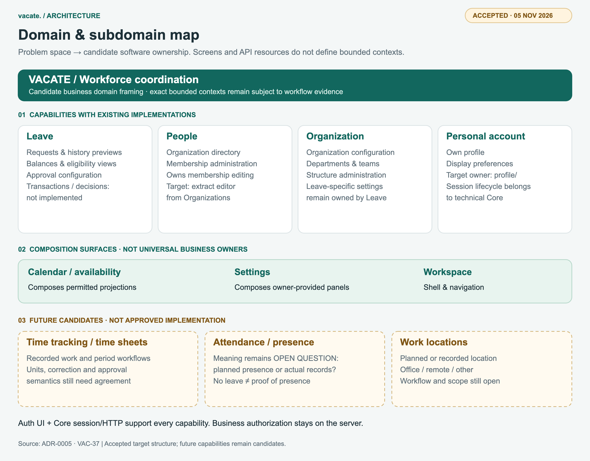
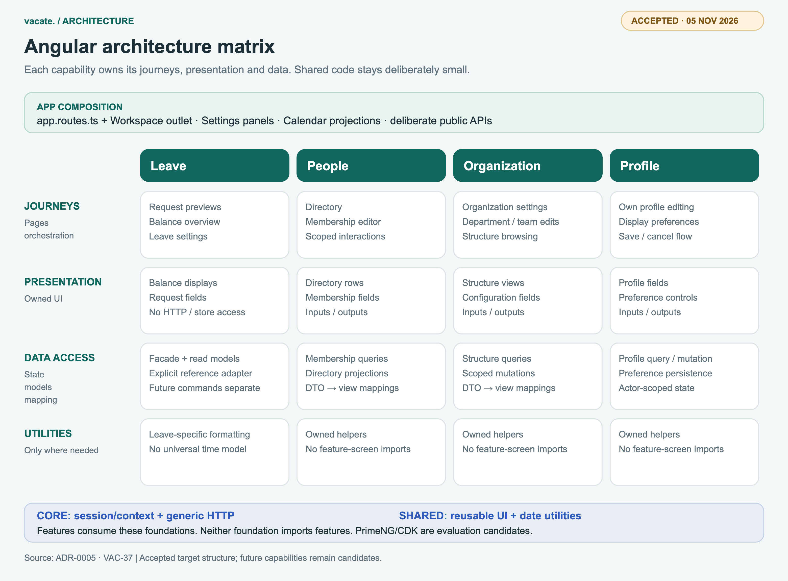
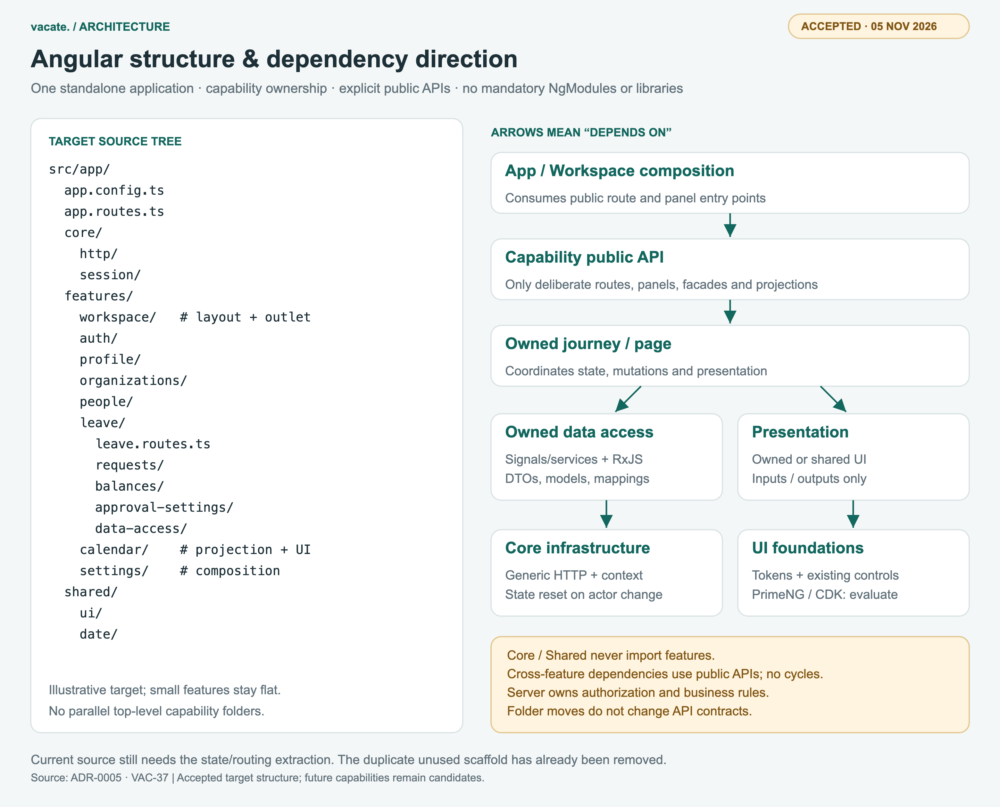

# Vacate architecture diagrams

Accepted target architecture, 2026-11-05. [ADR-0005](../../adr/0005-frontend-capability-architecture.md) owns the decision; [VAC-37](../../jira/VAC-37-frontend-architecture-review.md) records review and verification. These pictures describe the target, not completed refactoring or approved future product scope.

## Domain and subdomain map

[Editable SVG](domain-map.svg). Leave, People, Organization and Personal account are candidate ownership groupings grounded in existing workflows. Future time sheets, attendance/presence and locations are separate candidates. Leave transactions remain unimplemented. Accepted frontend ownership does not establish formal business bounded contexts or core/supporting/generic DDD classifications.

## Angular architecture matrix

[Editable SVG](architecture-matrix.svg). Read columns as owners and rows as responsibilities, not mandatory folders/libraries. Owned presentational components receive inputs and emit outputs; pages coordinate state and transport through their owner's services. Shared presentation stays business-neutral. Small features need not reproduce every row as a directory.

## Angular structure and dependencies

[Editable SVG](angular-structure.svg). Arrows mean “depends on”, not runtime data flow. Cross-capability imports use deliberate public APIs and remain acyclic; Core/Shared never import features. Not every allowed dependency is drawn. Existing active routes still load the shared Workspace: independent capability loading is a migration target. PrimeNG/CDK remain evaluation candidates.

## Source and reproduction

Original Vacate diagrams informed by Manfred Steyer's [Modern Architectures with Angular — Part 1](https://www.angulararchitects.io/en/blog/modern-architectures-with-angular-part-1-strategic-design-with-sheriff-and-standalone-components/) (published 2023-07-31, reviewed 2026-11-05). The article's subdomain map and feature/UI/data/util matrix inform the presentation. Vacate retains `features/`, standalone Angular, small explicit APIs and current tooling; the diagrams do not select Sheriff, Nx or the article's exact layering rules.

Run `python3 docs/design/architecture/generate.py` from the repository root to regenerate the editable SVGs, using only the Python standard library. Add `--render` to export PNGs at twice the SVG resolution with local macOS Google Chrome. Use `--diagram angular-structure` with `--render` to export just one PNG. Each SVG includes a title and text description; the PNGs have Markdown alternatives above. Colors reuse Vacate's green, ink, muted and amber tokens; text and dashed outlines also distinguish future candidates.

Verification: parse SVG XML; check local document/image links and rendered PNG dimensions; visually inspect all three PNGs for readability and clipping. This documentation adds no runtime UI, API, dependency or tenant-data path changes, so application tests and tenant-isolation execution are not applicable to the diagrams.
