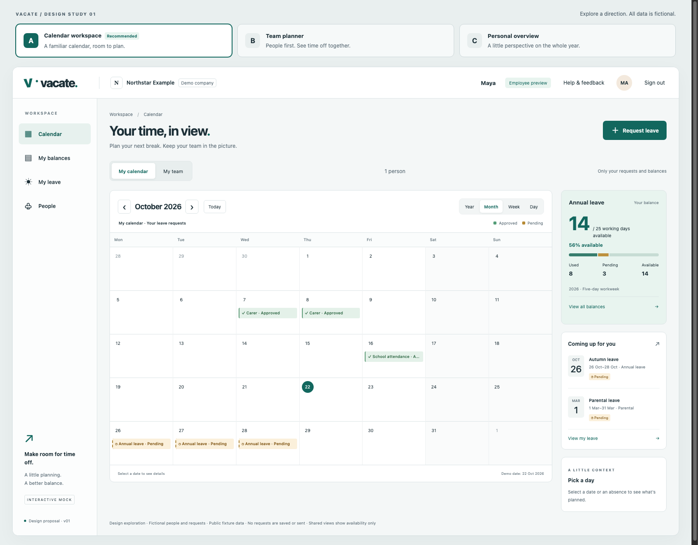
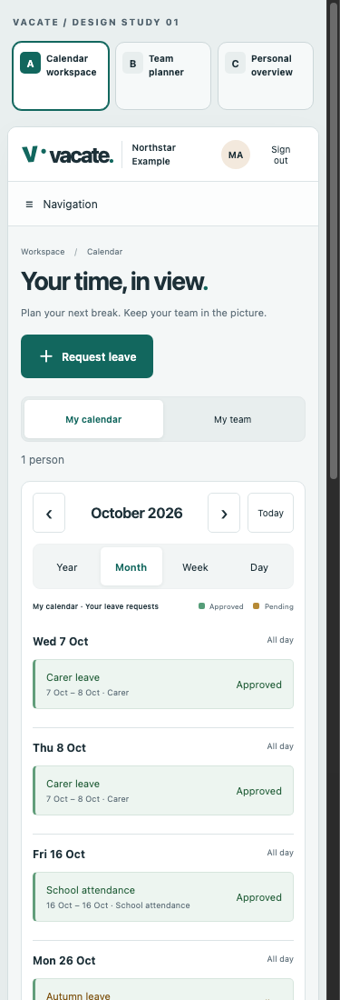
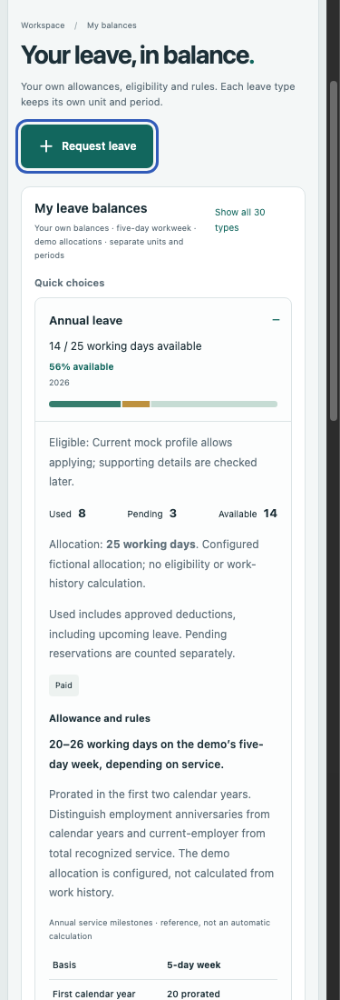

# VAC-10 conversion verification — 2026-10-25

The Angular project now lives in `frontend/`. The old static gallery renderer is retired; actual Angular templates/components own login, calendar, annual overview, balances, allowance details, dialogs and request previews. The reviewed domain functions are imported factories behind the typed DemoData service. No dependency version or real backend behavior changed.

## Local checks

- Angular strict application/template compilation and AOT emission pass with the existing Angular 22.2.3 compiler and Node 22.22.3. Test TypeScript compilation passes.
- The fixture suite passes against the imported Angular domain factories: 12 identities, exact scope/group rosters, ledger reconciliation, stale/unknown identities, foreign contexts, privacy, profile gates, missing facts and unsupported country.
- All 12 own responses / 360 decisions validate against the existing JSON schema; unsupported statuses and raw medical fields are rejected.
- Eleven cloud-smoke regression tests pass, including old API/frontend revision separation, CORS, legacy-gallery rejection and missing Angular bundle rejection.
- Packaging validation preserves the Angular index exactly, writes revision metadata, creates no second app.html and rejects legacy gallery scripts. Workflow/config path assertions pass.
- Issue/backlog keys, dependencies, graph and current frontend documentation links pass. Whitespace checks exclude unrelated pre-existing changes in docs/next-up.md and .DS_Store.

The native production bundler remains incompatible with this Mac, as recorded in the earlier build check. For local browser verification, ngc emitted the actual AOT application to `/private/tmp/vacate-angular-aot`; a temporary HTTP server supplied installed Angular/RxJS ES modules through an import map. This is application/template verification, not a claimed production build. Hosted CI must still build/test the optimized artifact.

## Browser acceptance and review

All functional journeys passed against the AOT Angular application: all 12 accounts/aliases, independently expected permissions/rosters and profile-filtered shortlist order; own requests/annual quantities; sanitized shared availability; denied identifiers and planned admin guards; actual logout/account-switch history; calendar/balances navigation, refresh, retained period/context and expanded uncommon balance state; known zero annual allocation; all 30 reference types, unknown quantities, separate units/projections and denied/forged/stale-session previews; all A/B/C calendar scopes/views and mobile overflow checks. Eleven screenshots were captured. Calendar desktop, mobile and balances mobile were visually reviewed.

Trusted keyboard checks passed separately in a fresh Chrome process: Enter activation, Escape/cancel, focus return, shortlist expansion/collapse, pinned uncommon selection and preserved dates/amount/unit/rules. Earlier headless pointer deliveries were intermittently absent even when protocol calls acknowledged them. The final harness uses trusted keyboard activation, runs keyboard before history traversal, waits for Angular render frames and tolerates only destroyed evaluation contexts during document navigation. Product assertions are retained. CI runs the default complete suite without the isolated-native diagnostic flag.

QA caught and fixed the mutable state handoff to the child calendar (group changes retained the previous roster) and a filtered-shortlist ordering difference. The existing independent browser expectations cover both; the Angular service also has a literal-order regression and own/foreign balance checks. Root BFCache restoration re-runs route/session guards for login and workspace routes.

## Release boundary

Hosted production build/unit/browser acceptance and deployment are pending. This local record does not establish server tenant isolation, production legal-policy correctness, real authentication, persistence or submission/approval behavior. The existing VAC-8/VAC-9 policy and design questions remain open.
