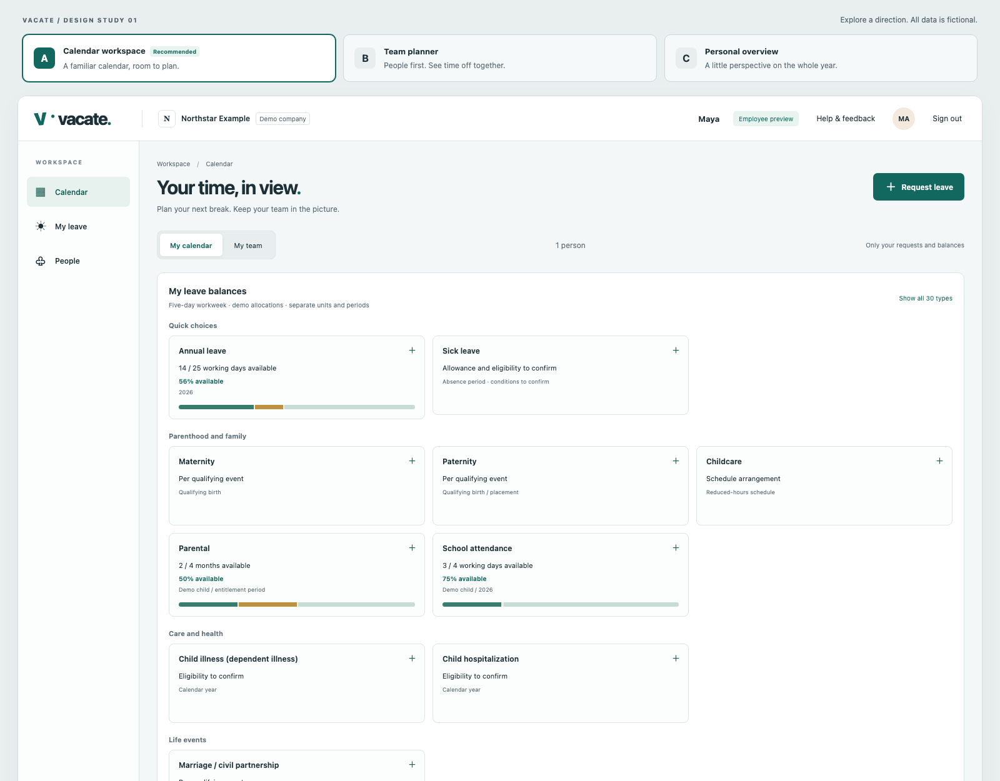
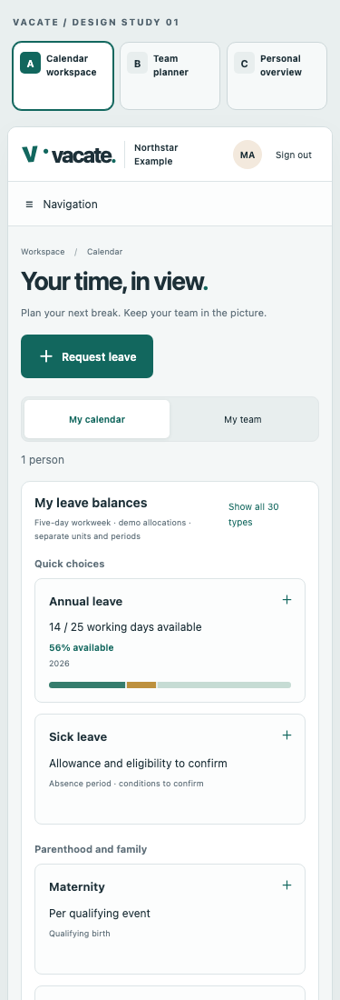

# VAC-5 local verification — 2026-10-23

**Target:** local working copy of `docs/design/calendar-mock/dist`; Node.js 22.22.3 and local headless Chrome. No cloud release is claimed. The founder authorized provisional defaults while keeping the questions open for revision; [issue and implementation comment C-4](../../VAC-5-common-leave-types-chooser.md).

Passed commands:

```sh
node --check docs/design/calendar-mock/dist/mock.js
node --check docs/design/calendar-mock/dist/leave-types.js
node --check docs/design/calendar-mock/verify.mjs
node docs/design/calendar-mock/verify-fixtures.mjs
MOCK_SCREENSHOT_DIR=/private/tmp/vacate-vac5-previews node docs/design/calendar-mock/verify.mjs
```

- All 12 canonical demo accounts and compatibility aliases; unchanged own ledgers, scope memberships and denied IDs; generic shared availability and real Back/Forward account resets.
- Same independently expected 12-type request/balance shortlist across accounts; annual/sick first, category groups, study included and postgraduate absent from defaults.
- All 30 catalogue entries and 29 requestable rule panels reachable; annual allocation supplement remains disabled.
- Native pointer/Enter expansion and collapse, retained uncommon selection and draft dates/quantity/open rules, focus return, uncommon balance example and retained expanded balance card.
- Sick leave has no allocation, bar or percentage for any persona; rule/source information and unknown projection remain explicit. Child illness preserves its original type ID/source allowance and shows children-only scope.
- Existing annual 14/25 (56%), parental months, school hours, unknown/excess projections and date-validation regressions pass. No request is saved and no balance is mutated.
- A/B/C mobile balance and request layouts fit at 375 px, including an uncommon selected postgraduate type after collapse. Eight PNGs captured; representative desktop/mobile images below were visually reviewed.

The first keyboard-test attempts omitted Enter's character payload; adding a complete native key event made the control test pass. The localhost browser server required execution outside the filesystem/network sandbox. These are local test-harness/environment details, not failed product acceptance in the final run.

This public single-company mock cannot prove server tenant isolation or production eligibility. Existing synthetic foreign company/person/group denials remain covered. The shortlist adds no API, persisted settings, medical evidence or profile-based ranking. Statutory sick-leave policy, the provisional product questions, full assistive-technology audit and hosted build/deployment remain open.

## Pre-commit review and QA — 2026-10-23

Requested by the founder before committing or deploying. An independent read-only review by the `vac5_review` agent found **no blocking functional, specification or privacy findings**. It checked that all original type rules/units/sources are preserved, all 30 entries remain reachable, the shortlist matches the authorized defaults, and child illness retains one underlying type/allowance.

The reviewer identified one nonblocking coverage gap: explicit draft-preservation assertions for the end date and school attendance's alternative hours unit. The browser suite now checks both dates, hours, amount and open rules across expansion/collapse, including that hours do not inherit a working-day balance. The complete browser suite passed again with these assertions, all 12 accounts, all 29 requestable rule panels and eight screenshots saved to `/private/tmp/vacate-vac5-review-previews`. This closes the test gap without changing product behavior.

Pre-commit checks also verified exact asset copying and retention of the Angular entry with a temporary packaging fixture, plus explicit `no-store` routes for the changed HTML/JS/CSS. The fixture uses a minimal Angular-shaped input to test packaging; it is **not** an Angular compilation or deployed-host test. Issue/backlog metadata, dependencies, local links, five retained open questions and whitespace checks pass.

**UX follow-up, not a blocker:** the authorized 12 balance cards extend the page before the calendar, especially on mobile. Shortlist membership and affected surfaces remain open for revision, so this can be revisited without treating the provisional defaults as final.

**Release sequence:** finish local review/QA → commit and push → hosted CI build/tests → deploy to the existing Azure dev target → hosted revision/routing/cache smoke and browser acceptance. A separate QA environment is not required for this static mock review. No commit, push, infrastructure change or deployment is authorized by this review record itself. VAC-5 stays in QA pending the hosted checks/release decision; its product questions remain open by request.

## Review images




