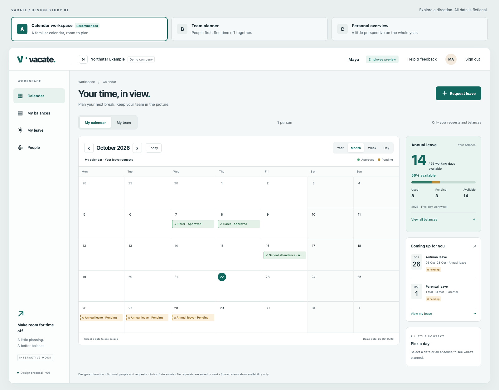
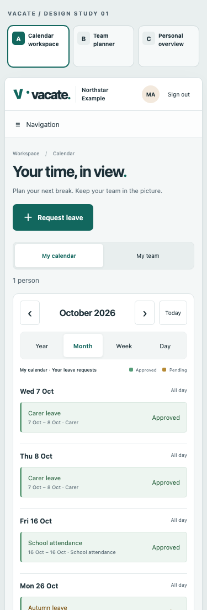
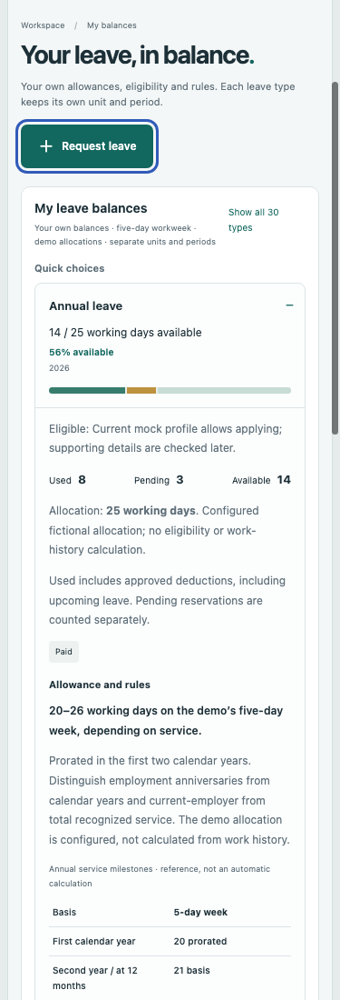

# VAC-8 / VAC-9 local acceptance

**2026-10-24 · local working copy, not a cloud release.** User-requested UI Architect and Frontend Engineer collaborated on the redesign; a separate policy review documented the current mock rules and source differences. [VAC-8](../../VAC-8-calendar-first-and-balances-page.md) owns layout/navigation; [VAC-9](../../VAC-9-eligibility-contract-and-mock-decisions.md) owns the country-profile mock/contract. Shared QA is recorded once here; no elapsed time has been inferred or summed across agents.

Passed final checks with Node.js 22.22.3, existing locked Angular AJV tooling, Python and local Chrome:

```sh
node --check docs/design/calendar-mock/dist/mock.js
node --check docs/design/calendar-mock/dist/leave-eligibility.js
node --check docs/design/calendar-mock/verify.mjs
node docs/design/calendar-mock/verify-fixtures.mjs
node docs/design/calendar-mock/verify-eligibility-contract.mjs
PYTHONDONTWRITEBYTECODE=1 python3 scripts/test_cloud_smoke.py
MOCK_SCREENSHOT_DIR=/private/tmp/vacate-vac8-vac9-previews node docs/design/calendar-mock/verify.mjs
git diff --check
```

- All 12 accounts, aliases, own-ledger quantities, scope memberships, foreign/unsupported identifiers and generic shared availability remain correct.
- A/B/C desktop calendar and annual rail align; annual is the only calendar balance and the calendar precedes it on mobile. Own annual values remain personal across shared scopes. Zero allocation produces no null percentage, NaN/Infinity or divided-by-zero bar.
- My balances works through navigation/annual link, direct query load, refresh and Back/Forward with retained calendar context, active navigation/title/skip link and focus.
- Each persona's visible shortlist is checked against an independent expected blocked-type list. Married Maya's default picker omits marriage; Show all retains all 30 reference types with unavailable request actions disabled. Unknown remains visible and unquantified.
- Gender/marital/child/sole-care profile checks follow the authorized provisional GR mock configuration. Missing facts and unsupported country remain To confirm; signed-out/foreign contexts receive no own response. Gender/family profile fields and decision reasons are absent from shared person/availability projections.
- All 12 response objects / 360 decisions validate against JSON Schema2020-12. Unsupported statuses and medical-data properties are rejected. No new package dependency was added.
- Forged denied/supplement options, example actions and submit attempts cannot finish a mock preview. A programmatic submit after session identity changes redirects instead of using the old view's eligibility/balance. Known Maya parental/school/carer and Iris study allocations stay unchanged where eligible.
- Existing unit, excess/unknown projection, source-rule, reversed-date, native Enter/Escape/focus, account reset and real history tests pass. A/B/C calendar/balances/request mobile overflow checks pass; final run captured 11 screenshots.
- A temporary Angular-shaped packaging fixture confirms exact current asset copying, inclusion of `leave-eligibility.js`, preservation of `app.html` and a no-store asset route. This is not an Angular compilation. Nine cloud-smoke helper regressions still pass, including frontend-only deployments.
- Issue/backlog identifiers, status/dependency links, graph, changed local document links and YAML/JSON syntax pass.

Independent source review caught annual zero-allocation rendering and a missing session check on submit; both are fixed with browser regressions. Browser harness synchronization now verifies trusted native-click delivery and aligns the Chrome window/viewport; it permits one bounded retry only if no click was delivered, never after a delivered click or failed application assertion. Final acceptance passed without weakening keyboard, focus or product assertions.

Visual review covered the calendar-first A/B layouts, mobile calendar ordering and dedicated balances presentation. Representative images from the final passing run:







**Limits/open review:** the profile shortcuts are founder-authorized mock behavior, not a verified Greece statutory rule pack. Adoption/special-maternity exceptions and remaining legal interpretation remain in the [review matrix](../../../product/leave-eligibility-review.md). No birth registry, upload, company overrides, real backend eligibility endpoint, production tenant isolation, full assistive-technology audit, hosted build or deployment is claimed. The public assets contain fictional profile data only. Future backend gates remain in the [contract](../../../contracts/leave-eligibility.md).

**2026-10-25 release follow-up:** [Azure dev release evidence](../../../release-2026-10-25-calendar-eligibility.md) records successful CI, frontend-only deployment of `0ca66c9`, exact live revision and the complete live browser suite. The limits above describe this local record; production policy/server gates remain open.
